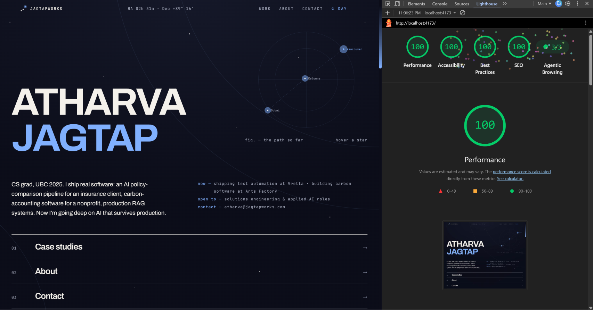

# JagtapWorks Portfolio — v3 "Day Chart / Night Chart"

Personal portfolio of **Atharva Jagtap**. Software engineer, UBC Computer Science '25.

Live at [jagtapworks.com](https://jagtapworks.com)

## The concept

The site is a star atlas with two lightings. **Day** reads like a vintage chart printed in ink: paper ground, cobalt accent, graticule arcs and printed star marks. **Night** is the same page with the lights off: twilight gradient, glowing stars, luminous cobalt. The ☉/☾ toggle in the header switches between them (system preference by default, persisted in localStorage).

Work is classified like star magnitudes throughout: **●** client work · **✦** startup · **✧** experiment.

## Tech stack

| Layer | Technology |
|-------|-----------|
| Framework | React 18 + Vite |
| Styling | Tailwind CSS 3 over CSS custom-property design tokens (one token set per theme) |
| Graphics | Hand-built inline SVG — constellation chart, site-wide sky field, brand mark. No WebGL, no animation library |
| SEO | react-helmet-async + JSON-LD structured data |
| Deployment | Cloudflare Pages |
| Fonts | Archivo (variable, width + weight axes) and JetBrains Mono, self-hosted woff2 |

## Sections

**Home** — Oversized name against an interactive constellation charting the real path (Dubai → Kelowna → Vancouver); hovering a star prints its chapter in the figure caption. A now/open-to/contact block and a numbered index of the site's sections.

**01 Case studies** — Expandable rows, newest first, each told as *problem → what I built → what broke → outcome*. The "what broke" notes are real. An experiments archive follows: image plate, two honest sentences, repo link, with the deeper cuts behind a "view full archive" toggle.

**02 About** — First-person bio, photo, credentials.

**03 Contact** — Email as display type, links, resume download.

**Footer** — Magnitude legend, certifications modal, copyright.

## Design system notes

- All copy lives in [`src/data/content.js`](src/data/content.js) — components are layout only
- Every color on the site is a CSS variable defined once per theme in [`src/index.css`](src/index.css)
- The scrollbar is a comet (WebKit browsers; Firefox gets a thin cobalt line)
- The brand mark ("gentle rise": two ink dots on an arc, terminating at Polaris) lives in [`src/components/Mark.jsx`](src/components/Mark.jsx); all raster brand assets (favicons, og-image, avatar, LinkedIn banner) regenerate from one script: `node scripts/gen-brand.mjs`
- Some things are not documented. Follow the star.

## Performance

**Lighthouse 100 / 100 / 100 / 100** — Performance, Accessibility, Best Practices, SEO — plus 3/3 on the agentic-browsing checks.



- No Three.js, no GSAP — all motion is CSS; the sky is static SVG with zero per-frame cost
- ~65 KB gzipped JS total (vendor included); easter-egg and modal chunks lazy-load on demand
- Self-hosted variable fonts with `<link rel="preload">` and `font-display: swap`
- WebP images with `loading="lazy"` and explicit dimensions
- Cloudflare `_headers` sets 1-year immutable cache on `/assets/*` and `/fonts/*`
- Motion always plays: the site deliberately ignores `prefers-reduced-motion`, since the choreography is part of the design and the OS flag is commonly off for non-accessibility reasons

## Getting started

```bash
npm install
npm run dev       # http://localhost:5173
npm run build     # production build → dist/
npm run preview   # preview the production build locally
```

Node 18+ required.

## Deployment

Deployed to **Cloudflare Pages** with automatic builds on push.

```
Build command:    npm run build
Output directory: dist
Node version:     18
```
